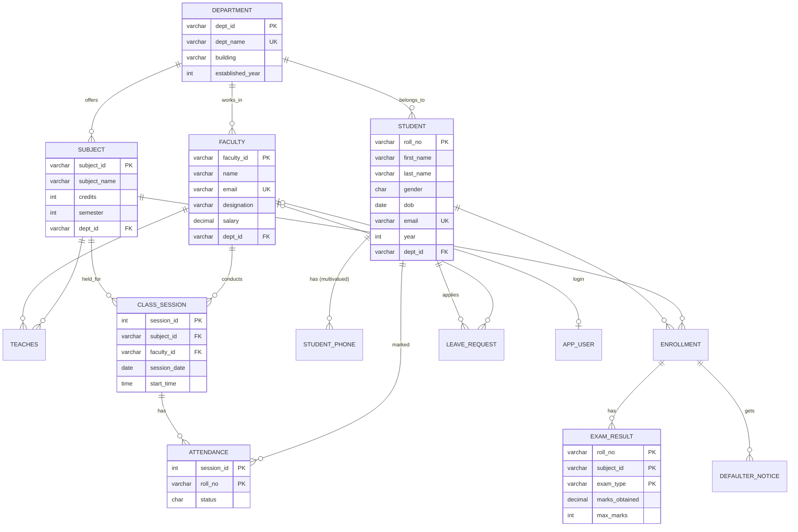

# 📘 CAAMS: Complete Project Guide (Hinglish)

**CAAMS = College Academic & Attendance Management System**

Ye guide aapko project ki har cheez samjhayegi:

- project kya hai aur syllabus ke kis topic ko kahan cover karta hai,
- kaise chalana hai,
- har file mein kya hai aur kaun si file kisko call karti hai,
- database design (ER diagram, tables, constraints, normalization, views, triggers, indexes),
- terminal ke har menu option (1, 2, 3 …) mein aap kya karte ho aur andar kya hota hai,
- viva ke liye important questions.

---

## 📑 Index

1. [Project ek nazar mein](#1-project-ek-nazar-mein)
2. [Syllabus → Project mapping](#2-syllabus--project-mapping)
3. [Kaise chalaye (Run karna)](#3-kaise-chalaye-run-karna)
4. [Folder structure: har file ka kaam](#4-folder-structure-har-file-ka-kaam)
5. [Architecture aur call flow (kaun kisko call karta hai)](#5-architecture-aur-call-flow-kaun-kisko-call-karta-hai)
6. [Database design](#6-database-design)
7. [Menu-by-menu guide (har option detail mein)](#7-menu-by-menu-guide-har-option-detail-mein)
8. [Lab assignments 1-5 kahan hain](#8-lab-assignments-1-5-kahan-hain)
9. [Viva questions (with answers)](#9-viva-questions-with-answers)
10. [Troubleshooting](#10-troubleshooting)

---

## 1. Project ek nazar mein

Ye ek **terminal (command-line) based DBMS project** hai. Real-time problem ye hai:

> College mein students ki **attendance**, **exams/results**, **leave requests** aur **defaulter list (< 75% attendance)** manage karna.

Is project ke do hisse hain:

| Hissa | Kya hai |
|---|---|
| **Application** (menu 1–6) | Ek working college system. Students add/update/delete karo, attendance lo, marks daalo, defaulters nikalo, reports dekho. Yahi **Lab Assignment 5** hai (real-time problem, front end + back end). |
| **Syllabus Labs** (menu 7–12) | Har unit ka live demo: relational algebra, SQL assignments 1-4, normalization calculator, B+ tree/hashing visualizer, transaction/locking simulator, recovery. |
| **Tools** (menu 13–14) | SQL console aur database administration (ER diagram, backup, CSV export, integrity check). |

**Technology:**

- **Front end** = terminal UI (menus, colored tables, bar charts). Code `src/ui/` aur `src/modules/` mein hai.
- **Back end** = **SQLite** database (`data/college.db`). Python ke built-in `sqlite3` module se use hota hai.
- **Language** = Python 3 (3.9 ya naya). **Koi external package nahi** chahiye, `pip install` ki zaroorat nahi (sirf standard library).

**Kuch numbers:** 14 tables, 6 views, 10 triggers, 7 custom indexes, 28 students, 10 faculty, 12 subjects, ~345 class sessions, ~2100 attendance records, ~220 exam marks. Ye sab first run pe auto-generate hota hai.

---

## 2. Syllabus → Project mapping

| Syllabus topic | Project mein kahan hai |
|---|---|
| **Introduction**: purpose of DB, view of data, DB languages, architecture, types of DB | Menu **7 (DBMS Concepts Tour)** |
| **E-R model**: entity, attributes, relationships, constraints | Menu **14 → 1** (ER diagram), section [6.1](#61-er-diagram) |
| Composite / derived / multivalued attributes | `student` (first+last name = composite), `age` (derived, view mein), `student_phone` (multivalued) |
| **Relational model**: keys, domains, integrity, referential constraints, schema diagram | `sql/01_schema.sql`, Menu **14 → 2** (data dictionary) |
| **Relational algebra**: fundamental, additional, extended operations, null values, modification | Menu **8 (Relational Algebra Lab)**, sabhi 10 options |
| **SQL**: basic structure, aggregates, nested subqueries, complex queries | Menu **9 (Lab Assignments)**, Menu **6 (Reports)**, Menu **13 (SQL Console)** |
| **Normalization**: FDs, 1NF→BCNF, 3NF, decomposition | Menu **10 (Normalization Lab)**, section [6.3](#63-normalization-humne-bcnf-tak-kaise-pahucha) |
| **Indexing**: ordered indices, B+ tree, static & dynamic hashing, B-tree, bitmap | Menu **11 (Indexing & Hashing Lab)**, `sql/04_indexes.sql` |
| **Transactions**: states, concurrent execution, serializability, recoverability, isolation | Menu **12 → 1, 2, 3, 4, 5** |
| **Concurrency control**: locking, timestamps, validation, deadlock | Menu **12 → 6, 7, 8** |
| **Recovery** + **ARIES** (self-study) | Menu **12 → 10** |
| **Network model** (self-study) | Menu **7 → 6** |
| **Views** (self-study) | `sql/02_views.sql` (6 views used everywhere) |
| **Multivalued dependencies** (self-study) | Menu **10 → 4**, `student_phone` table |
| **Multiple granularity** (self-study) | Menu **12 → 9** |
| **Lab 1, 2a, 2b, 3, 4** | Menu **9 → 1…5** |
| **Lab 5** (mini project + ER + normalization) | Pura application (menu 1-6) + ER diagram + normalization proof |

---

## 3. Kaise chalaye (Run karna)

### Requirement
- **Python 3.9 ya usse naya.** Check karne ke liye: `python3 --version`. macOS ka built-in `python3` (3.9) bhi chal jaata hai.
- MySQL, XAMPP, ya `pip install`: **kuch nahi chahiye.**

### Start
```bash
python3 main.py
```
Pehli baar chalane pe database apne aap ban jaata hai: `sql/*.sql` files run hoti hain aur sample data generate hota hai.

### Login accounts
| Username | Password | Role | Kya kar sakta hai |
|---|---|---|---|
| `admin` | `admin@123` | admin | Sab kuch (delete, reset, add faculty, SQL console mein write access) |
| `fac101` | `fac101@123` | faculty | Sirf **apne subjects** ki attendance/marks, SQL console **read-only** |
| `fac102` … `fac110` | `fac102@123` … | faculty | Same as above |

> 💡 Admin ko kuch extra options dikhte hain (jaise "Delete student"). Isliye **faculty login mein menu numbers thode alag** ho sakte hain. Is guide mein numbers **admin login** ke hisaab se diye gaye hain.

### Other commands
```bash
python3 main.py --reset
```
Database delete karke fresh data ke saath dobara banata hai.

```bash
python3 main.py --export-sql
```
Saari lab queries `sql/lab_assignments.sql` mein likh deta hai (print/submission ke liye).

```bash
python3 -m unittest discover tests
```
7 automated tests chalata hai (constraints, triggers, transactions, normalization, 2PL, B+ tree).

```bash
sqlite3 data/college.db
```
Database ko seedha SQLite CLI mein kholne ke liye (optional).

### Navigation tips
- Har menu mein **number type karo aur Enter dabao**. **0 = back / exit.**
- `[default]` brackets mein jo value dikhe, sirf Enter dabane pe wahi value le li jaati hai.
- Har action ke baad "Press Enter to continue" aata hai.

---

## 4. Folder structure: har file ka kaam

```
DBMS/
├── main.py                      ★ ENTRY POINT: python3 main.py [--reset | --export-sql]
├── README.md                    → short English intro
├── GUIDE.md                     → ye file
│
├── sql/                         ★ DATABASE KA DIL (pure SQL)
│   ├── 01_schema.sql            → 14 CREATE TABLE + saare constraints (PK, FK, CHECK, UNIQUE…)
│   ├── 02_views.sql             → 6 views (attendance %, defaulters, result sheet…)
│   ├── 03_triggers.sql          → 10 triggers (business rules + audit log)
│   ├── 04_indexes.sql           → 7 secondary indexes
│   ├── 05_seed_base.sql         → master data (departments, faculty, students, subjects…)
│   └── lab_assignments.sql      → auto-generated: saari lab assignment queries
│
├── caams/                       ★ PYTHON PACKAGE (poora application)
│   ├── app.py                   → login + main menu + command-line options
│   ├── session.py               → logged-in user yaad rakhta hai (admin/faculty)
│   │
│   ├── db/                      ★ BACKEND LAYER
│   │   ├── connection.py        → SQLite connection + helpers all_/get/run/exec_/transaction
│   │   ├── init.py              → DB banata hai: sql files run + live data generate + users
│   │   └── auth.py              → password hashing (PBKDF2-SHA256) + login check
│   │
│   ├── ui/                      ★ FRONT END TOOLKIT
│   │   ├── term.py              → colors, tables, boxes, bar charts, input prompts
│   │   └── menu.py              → generic menu loop + error handling
│   │
│   ├── modules/                 ★ APPLICATION (Lab Assignment 5)
│   │   ├── students.py          → Menu 1: student CRUD
│   │   ├── faculty.py           → Menu 2: faculty, subjects, departments
│   │   ├── attendance.py        → Menu 3: attendance lena / dekhna / sudharna
│   │   ├── results.py           → Menu 4: marks, grades, SGPA
│   │   ├── defaulters.py        → Menu 5: defaulter list, notices, leaves
│   │   ├── reports.py           → Menu 6: dashboard & analytics
│   │   ├── lab_assignments.py   → Menu 9: Lab assignments 1-4
│   │   ├── sql_console.py       → Menu 13: SQL console
│   │   └── admin.py             → Menu 14: ER diagram, backup, export, integrity
│   │
│   └── labs/                    ★ SYLLABUS LABS
│       ├── concepts.py          → Menu 7: Unit 1 concepts
│       ├── relational_algebra.py → Menu 8: RA operators
│       ├── normalization.py     → Menu 10: normalization UI
│       ├── indexing.py          → Menu 11: indexing UI
│       ├── transactions.py      → Menu 12: transactions UI
│       └── algorithms/          → pure logic (no UI), testable
│           ├── fd.py            → closure, keys, canonical cover, NF test, 3NF/BCNF decomposition
│           ├── index_structures.py → B+ tree, static hash, extendible hash, bitmap
│           └── concurrency.py   → serializability, 2PL, timestamp, validation, recovery
│
├── tests/test_core.py           → automated tests (python3 -m unittest discover tests)
├── data/college.db              → ASLI DATABASE FILE (auto-created)
├── exports/                     → CSV exports yahan aate hain
├── backups/                     → database backups yahan aate hain
└── legacy/                      → purane versions: Express + MySQL web app, aur nodejs-terminal/ (ye hi app JavaScript mein)
```

### Files ka detail (kya hai + kaun call karta hai)

| File | Andar kya hai | Kaun isko call karta hai | Ye kisko call karta hai |
|---|---|---|---|
| `main.py` / `caams/app.py` | `main()`: command-line options; `run()`: DB ensure karta hai → `login()` → main menu (`run_menu`) | `python3 main.py` | `db/init`, `db/auth`, `session`, `ui/menu`, saare `modules/*` aur `labs/*` |
| `caams/db/connection.py` | `get_db()`, `all_()`, `get()`, `run()`, `exec_()`, `transaction()`, `run_sql_file()`, `delete_database_files()` | **Har** module aur lab | Python `sqlite3` module |
| `caams/db/init.py` | `ensure_database()`, `initialize()`, `reset_database()`, `generate_live_data()` | `app.py`, `admin.py` (reset), `python3 main.py --reset`, tests | `connection.run_sql_file()` for `sql/01..05`, `auth.hash_password()` |
| `caams/db/auth.py` | `hash_password()`, `verify_password()`, `login()` | `app.py` (login), `init.py` (users banane), `admin.py` & `faculty.py` (password) | `hashlib` (PBKDF2-SHA256), `hmac` |
| `caams/session.py` | current user, `is_admin()`, `faculty_id()` | `menu.py` (admin-only items chhupane), `attendance.py`, `results.py`, `sql_console.py` | — |
| `caams/ui/term.py` | `table()`, `box()`, `bar()`, `bar_chart()`, `print_sql()`, `ask()`, `ask_text()`, `ask_int()`, `pick()`, `confirm()` | Har screen | `input()` / `sys.stdin` |
| `caams/ui/menu.py` | `run_menu()` (loop: menu dikhao → choice lo → action chalao → error pakdo), `friendly_error()` | `app.py` + har module/lab ka `menu()` | `term.py`, `session.py` |
| `caams/modules/*.py` | Har file ek `menu()` function deti hai jo `run_menu` se options dikhata hai; har option ek function hai jo SQL chalata hai | `app.py` | `connection.py` (SQL), `term.py` (output) |
| `caams/labs/*.py` | Syllabus demo screens | `app.py` | `labs/algorithms/*` (logic) + `connection.py` (real DB demos) |
| `caams/labs/algorithms/*.py` | Pure algorithms, sirf input → output | `labs/*.py`, `tests/` | kuch nahi |

---

## 5. Architecture aur call flow (kaun kisko call karta hai)

### 5.1 Layered architecture

```
┌──────────────────────────────────────────────────────────────┐
│  USER (keyboard)                                             │
└───────────────┬──────────────────────────────────────────────┘
                │ number / text input
┌───────────────▼──────────────────────────────────────────────┐
│  FRONT END   caams/ui/term.py  (ask, table, bar …)           │
│              caams/ui/menu.py  (run_menu loop)               │
└───────────────┬──────────────────────────────────────────────┘
                │ action()
┌───────────────▼──────────────────────────────────────────────┐
│  APPLICATION caams/app.py → caams/modules/*, caams/labs/*    │
│  (business logic: kaunsa SQL chalana hai, kya dikhana hai)   │
└───────────────┬──────────────────────────────────────────────┘
                │ db.all_(sql, params) / db.run / db.transaction
┌───────────────▼──────────────────────────────────────────────┐
│  DATA ACCESS caams/db/connection.py                          │
└───────────────┬──────────────────────────────────────────────┘
                │ prepared statements
┌───────────────▼──────────────────────────────────────────────┐
│  DBMS ENGINE SQLite: parser → optimizer → B-tree storage     │
│              constraints, triggers, views, transactions      │
└───────────────┬──────────────────────────────────────────────┘
                ▼
           data/college.db  (disk file)
```

### 5.2 Program start hone pe kya hota hai (startup flow)

```
python3 main.py
  └─► caams.app.main()
        └─► run()
              ├─► init.ensure_database()
              │     ├─ connection.is_initialized()?  ── haan ──► skip
              │     └─ nahi ──► initialize()
              │            ├─ BEGIN TRANSACTION
              │            ├─ run_sql_file('01_schema.sql')      → tables
              │            ├─ run_sql_file('02_views.sql')       → views
              │            ├─ run_sql_file('03_triggers.sql')    → triggers
              │            ├─ run_sql_file('04_indexes.sql')     → indexes
              │            ├─ run_sql_file('05_seed_base.sql')   → master data
              │            ├─ generate_live_data() → sessions, attendance, leaves, marks, users
              │            ├─ COMMIT
              │            └─ ANALYZE  (optimizer ke liye statistics)
              ├─► login()  → auth.login(user, pw) → app_user table check → session.set_user(u)
              └─► run_menu('MAIN MENU', …)  → user ki choice pe module.menu() call
```

### 5.3 Ek example: "Take attendance" pe andar kya-kya call hota hai

```
Main menu "3" ─► attendance.menu()  (run_menu)
   "1" ─► take_attendance()
           ├─ my_subjects()           → SELECT … teaches JOIN faculty (sirf apne subjects)
           ├─ ui.pick() / ui.ask_text()   → subject, date, time, topic input
           ├─ roster query            → enrollment JOIN student LEFT JOIN v_attendance_summary
           ├─ absent roll numbers input
           └─ db.transaction(work)  # def work():
                 INSERT INTO class_session …            ← trigger trg_session_not_in_future check
                 INSERT INTO attendance … (har student)  ← trigger trg_attendance_must_be_enrolled
              })                                        ← sab ek saath COMMIT, ya error pe ROLLBACK
```

### 5.4 Ek example: Error handling flow
Agar user galat data daale (jaise duplicate roll no), to flow aisa hota hai:
1. SQLite error (`sqlite3.IntegrityError`) raise karta hai: `UNIQUE constraint failed: student.roll_no`
2. `menu.py` ka `try/except` usko pakadta hai.
3. `friendly_error()` usko readable message bana deta hai: *"Duplicate value - UNIQUE/PRIMARY KEY violated on student.roll_no"*
4. Program crash **nahi** hota, aap wapas menu pe aa jaate ho.

---

## 6. Database design

### 6.1 ER Diagram



> Terminal mein bhi ER diagram dekh sakte ho: **Menu 14 → 1**.

**E-R concepts jo humne use kiye:**

| Concept | Example |
|---|---|
| Strong entity | `department`, `student`, `faculty`, `subject`, `class_session` |
| Weak-entity style | `attendance`: (session_id, roll_no) se identify hota hai, apni independent key nahi hai |
| Composite attribute | Student name = `first_name` + `last_name` |
| Derived attribute | `age` = `dob` se calculate (view `v_student_profile` mein) |
| Multivalued attribute | Student ke kai phone numbers → alag table `student_phone` |
| 1:N relationship | department → students, session → attendance |
| M:N relationship | student ↔ subject (`enrollment`), faculty ↔ subject (`teaches`) |
| Participation constraint | Har student ka department hona **zaroori** hai (`dept_id NOT NULL`) = total participation |
| Mapping cardinality | Ek subject ko ek academic year mein sirf ek faculty padhayega: `PRIMARY KEY (subject_id, academic_year)` in `teaches` |

### 6.2 Tables (14) aur unke constraints

| # | Table | Primary key | Important constraints |
|---|---|---|---|
| 1 | `department` | dept_id | dept_name UNIQUE, CHECK established_year 1950-2100 |
| 2 | `faculty` | faculty_id | email UNIQUE + CHECK format, CHECK designation IN (…), CHECK salary > 0, FK dept_id (ON DELETE RESTRICT) |
| 3 | `student` | roll_no | CHECK gender IN ('M','F','O'), CHECK year 1-4, email UNIQUE, DEFAULT admission_date, FK dept_id |
| 4 | `student_phone` | (roll_no, phone) | CHECK 10 digits only, FK roll_no ON DELETE CASCADE |
| 5 | `subject` | subject_id | CHECK credits 1-6, CHECK semester 1-8, CHECK type IN ('Theory','Lab') |
| 6 | `teaches` | (subject_id, academic_year) | FK faculty, FK subject |
| 7 | `enrollment` | (roll_no, subject_id) | 2 FKs with CASCADE |
| 8 | `class_session` | session_id (AUTOINCREMENT) | UNIQUE (subject_id, session_date, start_time), date/time CHECKs |
| 9 | `attendance` | (session_id, roll_no) | CHECK status IN ('P','A'), FK session ON DELETE CASCADE |
| 10 | `leave_request` | leave_id | CHECK from_date <= to_date (table-level CHECK), DEFAULT 'Pending', FK reviewed_by ON DELETE SET NULL |
| 11 | `exam_result` | (roll_no, subject_id, exam_type) | **Composite FK** → enrollment, CHECK marks <= max_marks, marks NULL = absent |
| 12 | `defaulter_notice` | notice_id | UNIQUE (roll_no, subject_id, issued_on), composite FK → enrollment |
| 13 | `app_user` | username | CHECK role, CHECK "faculty role ⇔ faculty_id present", password hashed |
| 14 | `audit_log` | log_id | sirf triggers isme likhte hain |

**Referential actions ka matlab:**
- `ON DELETE CASCADE`: parent delete hua to child rows bhi apne aap delete. Example: student delete karo to uski attendance, marks, phones sab chale jaate hain.
- `ON DELETE RESTRICT`: agar child rows exist karti hain to parent delete **nahi** hoga. Example: CS department delete nahi kar sakte jab tak usme students hain.
- `ON DELETE SET NULL`: faculty delete hua to `leave_request.reviewed_by` NULL ho jaayega.
- `ON UPDATE CASCADE`: primary key change hui to foreign keys bhi update ho jaati hain.

### 6.3 Normalization: humne BCNF tak kaise pahucha

Shuru mein socho, college ek hi Excel sheet mein sab rakhta:

```
ATTENDANCE_SHEET(roll_no, student_name, dept_id, dept_name, subject_id, subject_name,
                 faculty_id, faculty_name, session_id, session_date, status)
```

**Functional dependencies (FDs):**
```
roll_no            → student_name, dept_id
dept_id            → dept_name
subject_id         → subject_name
faculty_id         → faculty_name
session_id         → subject_id, faculty_id, session_date
session_id,roll_no → status
```
**Candidate key** = `{session_id, roll_no}`

| Step | Problem | Solution |
|---|---|---|
| **1NF** | Ek cell mein multiple phone numbers nahi hone chahiye | Phones alag table `student_phone` mein |
| **2NF** | `roll_no → student_name` **partial dependency** hai (key ka sirf ek part), isliye student ka naam har attendance row mein repeat hota | `student(roll_no, name, dept_id)` alag kiya. Same for `session_id → …` |
| **3NF** | `roll_no → dept_id → dept_name` **transitive dependency** hai | `department(dept_id, dept_name)` alag kiya. Same for subject, faculty |
| **BCNF** | Har FD ka LHS (determinant) superkey hona chahiye | Final tables mein har determinant us table ki key hai ✔ |

**Final decomposition** = `student`, `department`, `subject`, `faculty`, `class_session`, `attendance`. Ye **lossless join** hai aur **dependency preserving** bhi.

> 🔬 Ye pura analysis live dekhne ke liye: **Menu 10 → 1 → option 1** ("OUR PROJECT: un-normalised attendance sheet"). Lab khud keys nikalega, violations dikhayega aur decomposition karega.

**4NF / MVD:** `roll_no ↠ phone` aur `roll_no ↠ subject_id` independent hain. Isliye dono alag tables mein hain (`student_phone`, `enrollment`). Detail: **Menu 10 → 4**.

### 6.4 Views (6), file `sql/02_views.sql`

| View | Kya deta hai | Kahan use hota hai |
|---|---|---|
| `v_student_profile` | full name, **age (derived)**, dept name, phones (group_concat) | Student list/profile |
| `v_attendance_summary` | Har (student, subject) ke liye total, present, on_leave, `raw_pct`, `adjusted_pct`, `classes_needed` | Profile, register, defaulters, reports |
| `v_defaulters` | `adjusted_pct < 75` wale + risk (Critical < 50, High < 65, Moderate) | Defaulter menu, dashboard |
| `v_result_sheet` | Internal/MidSem/EndSem ko pivot karke total, %, **grade**, **grade point** | Results menu, SGPA |
| `v_subject_report` | Subject-wise faculty, enrolled, sessions, avg attendance, defaulters, avg marks | Subjects report, dashboard |
| `v_dept_stats` | Department-wise students, faculty, avg salary, avg attendance | Departments overview |

**Important formulas:**
- `raw_pct = present / total × 100`
- `adjusted_pct = (present + approved-leave absences) / total × 100`
- `classes_needed = max(0, 3T − 4P)`. Ye kahan se aaya: (P + x)/(T + x) ≥ 0.75 solve karo to x ≥ 3T − 4P aata hai.
- `SGPA = Σ(credits × grade_point) / Σ credits`

### 6.5 Triggers (10), file `sql/03_triggers.sql`

| Trigger | Kab chalta hai | Kya karta hai |
|---|---|---|
| `trg_attendance_must_be_enrolled` | BEFORE INSERT on attendance | Agar student us subject mein enrolled nahi hai to **RAISE(ABORT)** |
| `trg_session_not_in_future` | BEFORE INSERT on class_session | Future date ka session block |
| `trg_leave_review_once` | BEFORE UPDATE on leave_request | Ek baar Approved/Rejected ho gaya to dobara change nahi |
| `trg_audit_attendance_update` | AFTER UPDATE on attendance | Old/new status `audit_log` mein |
| `trg_audit_attendance_delete` | AFTER DELETE on attendance | Delete hua record log |
| `trg_audit_student_insert/update/delete` (3) | student pe INSERT/UPDATE/DELETE | Changes log (update mein JSON old/new) |
| `trg_audit_marks_update` | AFTER UPDATE on exam_result | Marks badle to log |
| `trg_audit_leave_review` | AFTER UPDATE on leave_request | Approval kisne kiya, log |

### 6.6 Indexes (7), file `sql/04_indexes.sql`

| Index | Columns | Kis query ko fast karta hai |
|---|---|---|
| `idx_student_dept_year` | student(dept_id, year) | "CS ke 3rd year students" |
| `idx_student_name` | student(last_name, first_name) | Name search / sorting |
| `idx_session_subject_date` | class_session(subject_id, session_date) | Subject ke sessions date-wise |
| `idx_attendance_roll` | attendance(roll_no, status) | Ek student ki poori attendance |
| `idx_result_subject` | exam_result(subject_id, exam_type) | Result sheet |
| `idx_leave_roll_status` | leave_request(roll_no, status, from_date, to_date) | Adjusted % calculation |
| `idx_faculty_dept` | faculty(dept_id) | Department ki faculty |

Plus PRIMARY KEY aur UNIQUE ke **automatic indexes**. Sab dekhne ke liye: **Menu 11 → 7**.

---

## 7. Menu-by-menu guide (har option detail mein)

Login ke baad **MAIN MENU** aata hai:

```
── APPLICATION ──
  1  🎓 Student management
  2  🏫 Faculty, subjects & departments
  3  📝 Attendance
  4  🏆 Exams & results
  5  ⚠️ Defaulters & leaves
  6  📈 Reports & analytics
── SYLLABUS LABS ──
  7  📚 DBMS concepts tour
  8  🔣 Relational algebra lab
  9  🧪 Lab assignments 1-4 (SQL)
 10  🧩 Normalization lab
 11  🌳 Indexing & hashing lab
 12  🔐 Transactions & concurrency lab
── TOOLS ──
 13  💻 SQL console
 14  🗄️ Database administration
  0  Exit
```
Upar ek status bar bhi hai: kaun logged-in hai, kitne students/sessions hain, kitne defaulters aur pending leaves. Ye sab live SQL se aata hai (`app.py → status_bar()`).

---

### 🎓 MENU 1: Student Management (`caams/modules/students.py`)

| Option | Aap kya karte ho (input) | Output | Andar kya ho raha hai |
|---|---|---|---|
| **1. List students** | Dept filter (CS/IT/ENTC/MECH ya blank), year filter | Students ki table (roll, name, gender, age, city, phones) | `SELECT … FROM v_student_profile WHERE (? = '' OR dept_id = ?) …`. Blank filter = sab. SQL bhi screen pe print hota hai. |
| **2. Search students** | Koi bhi text (naam/city/email) | Matching students | `LIKE '%text%'` pattern matching, 3 columns pe `OR` |
| **3. Student full profile** | Roll no ya naam ka hissa | Box mein details + har subject ka **attendance bar** + results + leave history | 4 queries: `v_student_profile`, `v_attendance_summary`, `v_result_sheet`, `leave_request`. Age **derived attribute** hai, phones **multivalued**. |
| **4. Add new student** | Dept, year, roll (auto-suggest), naam, gender, DOB, city, email, phones | "Student added and auto-enrolled in N subjects" | **Ek transaction** mein 3 kaam: `INSERT student` + `INSERT student_phone` (har phone) + `INSERT INTO enrollment SELECT …` (us dept/semester ke saare subjects). Koi bhi fail hua to sab ROLLBACK. Trigger audit_log mein entry likhta hai. Galat gender/year dene pe **CHECK constraint** rokta hai. |
| **5. Update student** | Student choose, naye values (Enter = purana value same) | "1 row updated" | `UPDATE student SET … WHERE roll_no = ?`. Trigger `trg_audit_student_update` old/new JSON log karta hai. Optional: naya phone add. |
| **6. Enrol in a subject** | Student, phir doosra subject (elective) | Enrolled | M:N relationship mein naya row: `INSERT INTO enrollment`. List `NOT IN` subquery se banti hai (jo already enrolled hain wo nahi dikhte). |
| **7. Delete student** *(admin)* | Student, confirm | Pehle dikhata hai kitni child rows delete hongi, phir delete | `DELETE FROM student`. **ON DELETE CASCADE** se enrollment, attendance, marks, phones, leaves apne aap delete. Audit trigger log karta hai. |

---

### 🏫 MENU 2: Faculty, Subjects & Departments (`caams/modules/faculty.py`)

| Option | Input | Output | Andar kya ho raha hai |
|---|---|---|---|
| **1. Departments overview** | — | Har dept ke students, faculty, avg salary, avg attendance, defaulter students | View `v_dept_stats` (scalar subqueries) |
| **2. Faculty list with subjects** | — | Faculty + unke subjects (comma separated) | `LEFT JOIN teaches` + `group_concat`. **LEFT** isliye ki FAC110 (koi subject nahi) bhi dikhe. |
| **3. Subjects report** | — | Subject, faculty, enrolled, sessions, avg attendance (colored), defaulters, avg marks | View `v_subject_report` |
| **4. Faculty workload** | — | Table + **bar chart** of sessions taken | 4 tables ka LEFT JOIN + `COUNT(DISTINCT)`, `SUM(credits)` |
| **5. Add faculty** *(admin)* | Dept, ID (auto), naam, email, designation, salary | Faculty + login account create | Transaction: `INSERT faculty` + `INSERT app_user` (hashed password `id@123`) |
| **6. Add subject** *(admin)* | Dept, code, naam, credits, semester, lab? | Subject create + optional auto-enroll | `INSERT subject` phir `INSERT INTO enrollment SELECT roll_no … WHERE year*2-1 = semester` |
| **7. Allocate subject** *(admin)* | Subject, faculty | "now taught by …" | **UPSERT**: `INSERT … ON CONFLICT (subject_id, academic_year) DO UPDATE` |

---

### 📝 MENU 3: Attendance (`caams/modules/attendance.py`)

> Faculty login mein sirf **apne subjects** dikhte hain (`WHERE t.faculty_id = ?`). Admin ko sab dikhte hain.

| Option | Input | Output | Andar kya ho raha hai |
|---|---|---|---|
| **1. Take attendance** | Subject → date (default aaj) → time → topic → roster dikhega → **absent students ke serial no / roll no** comma se (blank = sab present, `each` = ek-ek karke P/A) | "Session #N saved: X present, Y absent (1 transaction, N INSERTs)" | `db.transaction()` mein 1 `INSERT class_session` + har student ka `INSERT attendance`. Trigger check karte hain: future date nahi, student enrolled hona chahiye. Ek bhi fail hua to **poora rollback (atomicity)**. |
| **2. View a session** | Subject → recent 15 sessions list → ek choose | Students ke saath Present (green) / Absent (red) | `attendance JOIN student WHERE session_id = ?` |
| **3. Attendance register (grid)** | Subject | Last 12 sessions ka **P/A grid** + overall % bar | Sessions aur attendance alag-alag fetch, JS mein pivot (rows = students, columns = dates) |
| **4. Correct an entry** | Subject → session → roll no → confirm | P↔A toggle + audit log row dikhata hai | `UPDATE attendance SET status = …`. Trigger `trg_audit_attendance_update` change record karta hai (tamper-proof trail). |
| **5. Day-wise report** | Date (default last session date) | Us din ke saare sessions + present/absent/% | `GROUP BY session_id` with `SUM(status='P')` |
| **6. Delete a session** *(admin)* | Subject → session → confirm | Session delete | `DELETE class_session`, attendance rows **CASCADE** se delete, trigger log karta hai |

---

### 🏆 MENU 4: Exams & Results (`caams/modules/results.py`)

| Option | Input | Output | Andar kya ho raha hai |
|---|---|---|---|
| **1. Enter / update marks** | Subject → exam (Internal/20, MidSem/30, EndSem/50) → har student ke marks (Enter = same, `ab` = absent) | "N marks saved" | Ek transaction mein **UPSERT** (`ON CONFLICT DO UPDATE`). `ab` = **NULL** store hota hai. CHECK `marks <= max_marks` galat marks rokta hai. Change hone pe audit trigger. |
| **2. Subject result sheet** | Subject | Internal/Mid/End/total/%/grade table + **grade distribution chart** | View `v_result_sheet` (pivot using `MAX(CASE WHEN …)` + CASE for grade) |
| **3. Student marksheet + SGPA** | Student | Subject-wise grades + SGPA box | `SUM(credits*grade_point)/SUM(credits)` |
| **4. Subject toppers** | — | Top 3 per subject | **Window function** `DENSE_RANK() OVER (PARTITION BY subject_id ORDER BY percentage DESC)` |
| **5. Class SGPA ranking** | — | Sab students SGPA order mein + backlogs | `GROUP BY roll_no`, `SUM(grade='F')` |
| **6. Attendance vs marks** | — | Regular vs defaulter students ke avg marks + chart | 2 views ka JOIN + CASE grouping. Result: regular students ke marks zyada aate hain. |

---

### ⚠️ MENU 5: Defaulters & Leaves (`caams/modules/defaulters.py`)

| Option | Input | Output | Andar kya ho raha hai |
|---|---|---|---|
| **1. View defaulter list** | Dept filter (optional) | Defaulters: attended (P+leave/total), raw %, adjusted %, **classes needed**, risk (colored) + risk chart | View `v_defaulters` |
| **2. Generate notices** | Confirm | "N notices issued in one transaction" | `INSERT INTO defaulter_notice SELECT … FROM v_defaulters ON CONFLICT DO NOTHING`. UNIQUE (roll, subject, date) ki wajah se same din duplicate notice nahi banta. |
| **3. View / update notices** | Notice id, new status | Updated | `UPDATE defaulter_notice SET status` (CHECK: Issued/Acknowledged/Cleared) |
| **4. Apply leave** | Student, from, to, type, reason | "Leave request #N submitted (Pending)" | `INSERT leave_request`. `status` **DEFAULT 'Pending'**. CHECK `from_date <= to_date`. |
| **5. Approve / reject leaves** | Pending leave choose, decision | **Before/after adjusted %** table | `UPDATE leave_request SET status`. View automatically recalculate hota hai (approved leave wale absent days "present-equivalent" ban jaate hain). Trigger dobara change hone se rokta hai. |
| **6. Leave history** | — | Saari leaves + reviewer naam | `LEFT JOIN faculty` (pending leaves ka reviewer NULL hai, isliye LEFT JOIN) |

---

### 📈 MENU 6: Reports & Analytics (`caams/modules/reports.py`)

| Option | Output | SQL concept |
|---|---|---|
| **1. College dashboard** | KPIs box + dept-wise aur subject-wise attendance bars | Multiple **scalar subqueries** ek SELECT mein |
| **2. Weekly trend** | Har week ka attendance % bar | `strftime('%Y-W%W')` + GROUP BY |
| **3. Weekday analysis** | Monday-Friday attendance % + chart | `CASE strftime('%w')` + GROUP BY |
| **4. Perfect attendance** | Jo kabhi absent nahi hue (subject-wise) | `NOT EXISTS` subquery |
| **5. Below dept average** | Jinka avg % unke department ke avg se kam hai | **Correlated subquery** in `HAVING` |
| **6. Absence streaks** | Lagatar 3+ absent rehne wale | **Window functions** (`ROW_NUMBER` difference = "gaps & islands" technique) |
| **7. City / gender** | City-wise male/female count (2+ students) | `GROUP BY … HAVING COUNT(*) >= 2` |

---

### 📚 MENU 7: DBMS Concepts Tour (`caams/labs/concepts.py`), Unit 1

| Option | Kya dikhata hai |
|---|---|
| **1. Purpose of DB systems** | File system ki problems (redundancy, integrity, atomicity, concurrency, security) vs is project mein unka solution |
| **2. Views of data** | Same data teen levels pe: **view** (`v_student_profile`), **logical** (`student` table), **physical** (B-tree root page number, page size). Physical aur logical data independence. |
| **3. Database languages** | DDL, DML, TCL, DCL: har ek ka example aur project mein kahan use hua |
| **4. DBMS architecture** | Diagram: users → application → query processor → storage manager → disk. Saath mein `sqlite_stat1` (optimizer statistics). |
| **5. Types of databases** | Relational, hierarchical, network, OO, NoSQL (document, key-value, column, graph), distributed, embedded |
| **6. Network model** *(self-study)* | Humara data CODASYL network model mein kaisa dikhta (owner-member sets, pointers) vs relational FKs |

---

### 🔣 MENU 8: Relational Algebra Lab (`caams/labs/relational_algebra.py`), Unit 3

**Kya special hai:** har operator **Python mein khud implement kiya gaya hai** (`RA.select`, `RA.project`, `RA.divide` …). Ye functions database ke tuples pe chalte hain. Phir **same cheez SQL se** chalayi jaati hai aur dono ke result compare hote hain: *"✔ SQL returned the same N tuples"*. Isse dikhta hai ki SQL relational algebra pe hi based hai.

| Option | Input | RA expression | SQL equivalent |
|---|---|---|---|
| **1. σ Selection** | Table + condition (jaise `year = 3 AND dept_id = 'CS'`) | σ year=3 ∧ dept_id='CS' (student) | `SELECT * … WHERE …` |
| **2. π Projection** | Table + attributes (jaise `city`) | π city (student) | `SELECT DISTINCT city` (projection duplicates hata deta hai, ye dikhaya jaata hai) |
| **3. ∪ ∩ − Set ops** | — | A = CS 3rd year, B = defaulters → A∪B, A∩B, A−B | `UNION`, `INTERSECT`, `EXCEPT` |
| **4. × Cartesian product** | — | department × subject (4 × 10 = 40 tuples), phir σ lagake **join** banta hai | `CROSS JOIN` → `JOIN … ON` |
| **5. ⋈ ⟕ Joins** | — | faculty ⋈ department (natural), faculty ⟕ teaches (left outer, FAC110 ke liye **NULL**) | `NATURAL JOIN`, `LEFT JOIN` |
| **6. ρ Rename + θ-join** | — | ρF1(faculty) ⋈ F1.salary < F2.salary ρF2(faculty) (self join) | `faculty F1 JOIN faculty F2 ON …` |
| **7. ÷ Division** | — | Students jo DBMS ke **har** lecture mein present the; students jo **saare** exams mein baithe | `NOT EXISTS … NOT EXISTS` (double negation), `GROUP BY … HAVING COUNT = …` |
| **8. 𝒢 Aggregation** | — | dept_id 𝒢 count, avg, max (faculty); generalized projection salary×12; NULLs ignore | `GROUP BY`, `AVG` |
| **9. ← Modification** | — | Insert (r ← r ∪ E), delete (r ← r − E), update (generalized projection). In-memory copy pe, real DB safe rehta hai. | INSERT/DELETE/UPDATE |
| **10. ∅ NULL values** | — | 3-valued logic: `NULL = NULL` → NULL, `NOT(marks > 10)` NULL rows ko count nahi karta | `IS NULL`, `COALESCE` |

---

### 🧪 MENU 9: Lab Assignments 1-4 (`caams/modules/lab_assignments.py`)

Syllabus ke lab assignments **exactly** yahan hain. Har question pe: question text → **colored SQL** → **live output table**.

| Option | Assignment | Questions | Topics |
|---|---|---|---|
| **1** | Assignment 1: Basic SQL | 13 | SELECT, WHERE, ORDER BY, LIKE, BETWEEN, IN, DISTINCT, JOIN, alias, string/date functions, IS NULL, LIMIT |
| **2** | Assignment 2(a): Aggregates | 11 | COUNT/SUM/AVG/MIN/MAX, GROUP BY (1 & 2 columns), HAVING, ORDER BY, COUNT(*) vs COUNT(col) |
| **3** | Assignment 2(b): Nested & updates | 15 | Scalar subquery, IN, NOT IN, NOT EXISTS, correlated, `> ALL` (MAX se), derived table, INTERSECT/EXCEPT, CTE + RANK, **UPDATE/DELETE with subqueries** |
| **4** | Assignment 3: DDL & DML | 9 | CREATE TABLE, multi-row INSERT, ALTER ADD/RENAME COLUMN/RENAME TO, INSERT…SELECT, UPDATE, DELETE, CREATE VIEW, DROP |
| **5** | Assignment 4: Schema & constraints | 7 | Library schema: PK, FK (CASCADE vs RESTRICT), UNIQUE, NOT NULL, CHECK, DEFAULT, **10 constraint-violation tests** (sab reject hote hain ✔), catalog (pragma) |
| **6** | Export | — | Sab queries → `sql/lab_assignments.sql` |

**Input:** Assignment 1/2a/2b mein question number do, ya `a` = sab questions. Assignment 3/4 poore step-by-step chalte hain.

**Sandbox (bahut important):** UPDATE/DELETE/DDL wale questions ek **SAVEPOINT** ke andar chalte hain aur end mein **ROLLBACK** hote hain. Matlab aap jitni baar chahe chalao, **asli college data kabhi kharab nahi hota**. Ye khud transactions ka ek live demo hai.

---

### 🧩 MENU 10: Normalization Lab (`caams/labs/normalization.py` + `algorithms/fd.py`), Unit 4

**Input format:**
- Relation: `ABCDE` (single letters) **ya** `roll_no, name, dept` (comma separated)
- FDs: `;` se alag. Example: `A -> BC; CD -> E; B -> D`

Presets ready hain: humare project ki attendance sheet, exam sheet, Silberschatz textbook example, EMP_PROJ (2NF), transitive example. Ya apna khud ka daalo.

| Option | Output | Algorithm (`fd.py`) |
|---|---|---|
| **1. Full analysis** | Step 1: har LHS ka closure (superkey mark). Step 2: **candidate keys**, prime/non-prime. Step 3: **canonical cover**. Step 4: 1NF/2NF/3NF/BCNF test with reason (partial / transitive / non-superkey). **Highest NF** badge. Step 5: **3NF synthesis** + **BCNF decomposition**, dono ka **lossless** aur **dependency-preserving** check. | `closure()`, `candidateKeys()`, `minimalCover()`, `analyze()`, `synthesis3NF()`, `bcnfDecompose()`, `losslessChase()`, `dependencyPreserved()` |
| **2. Attribute closure X⁺** | Step-by-step: kaunsi FD se kaunsa attribute add hua | `closure(X, F, trace)` |
| **3. Test MY decomposition** | Aap decomposition do (jaise `AB \| BC`). Lab **chase tableau** dikhata hai + lossless/dependency result. | Chase algorithm |
| **4. MVD & 4NF** | `roll_no ↠ phone` example, aur kyun `student_phone` alag table hai | — |

**Algorithms short mein:**
- **Closure X⁺:** X se start karo. Jab tak koi FD `L → R` mile jiska L ⊆ result ho, R add karte raho.
- **Candidate key:** Jo attributes kisi FD ke RHS mein nahi aate, wo har key mein zaroor honge (core). Phir core + chhote subsets try karo, aur minimal superkeys rakho.
- **Canonical cover:** RHS ko single attribute mein todo → LHS ke extraneous attributes hatao → redundant FDs hatao.
- **BCNF decomposition:** Violating FD X→Y mila to R ko (X∪Y) aur (R−Y) mein todo. Repeat karo.
- **3NF synthesis:** Canonical cover ki har FD ek table banti hai. Agar kisi table mein key nahi hai to ek key wali table add karo.

---

### 🌳 MENU 11: Indexing & Hashing Lab (`caams/labs/indexing.py` + `algorithms/index_structures.py`), Unit 5

| Option | Input | Output | Kya seekhoge |
|---|---|---|---|
| **1. B+ tree** | Order n (3-6), keys (apne, textbook names, roll numbers, ya 1-20) | Har insert ke baad **tree level-wise draw** hota hai, split events dikhte hain ("leaf overflow → split, copy up 12", "internal overflow → push up"). End mein search (path dikhata hai) aur range query `5..20` (leaf linked list pe walk). | Leaf ≤ n−1 keys, internal ≤ n children, balanced height, copy-up vs push-up |
| **2. Static hashing** | Buckets N, capacity, keys | `h(K) = K mod N`, buckets + **overflow chains** | Static hashing ki problem: data badhe to chains lambi |
| **3. Extendible hashing** | Capacity, keys | Har insert pe binary hash, **bucket split**, **directory doubling**, final directory with global/local depth | Dynamic hashing |
| **4. Bitmap index** *(self-study)* | — | Real `student` table pe gender/year/dept ke bitmaps, aur query `F AND year 3 AND CS` = **bitwise AND** | Low-cardinality columns ke liye bitmap |
| **5. EXPLAIN QUERY PLAN** | — | 6 real queries: plan (**SEARCH** = index use, **SCAN** = full table) + avg time µs | Primary index, secondary index, composite index, index disable, function on column se index nahi lagta |
| **6. Benchmark** | Rows (default 200,000) | Recursive CTE se 2 lakh rows banti hain. Index ke bina vs index ke saath time. **Speed-up ~100-200×.** | Indexing ka asli fayda + insert cost trade-off |
| **7. List indexes** | — | DB ke saare indexes (automatic + custom) with columns | Catalog |

---

### 🔐 MENU 12: Transactions & Concurrency Lab (`caams/labs/transactions.py` + `algorithms/concurrency.py`), Unit 6

**Part A: real SQLite pe (sach mein transactions chalte hain):**

| Option | Kya hota hai |
|---|---|
| **1. ACID demo** | Temporary `lab_account` table (A101 = ₹5000, B202 = ₹20000). (1) ₹1500 transfer → COMMIT. (2) ₹9999 transfer → CHECK `balance >= 0` fail → ROLLBACK. (3) ₹1000 transfer mein debit ke baad "power failure" → ROLLBACK. Har step pe transaction **state** print hoti hai (ACTIVE → PARTIALLY COMMITTED → COMMITTED / FAILED → ABORTED). Total paisa hamesha same rehta hai = consistency. |
| **2. Savepoints** | BEGIN → debit 500 → SAVEPOINT → debit 700 (galti) → `ROLLBACK TO` savepoint → COMMIT. Sirf galti wala hissa undo hota hai. |
| **3. Transaction state diagram** | ASCII diagram: Active, Partially committed, Committed, Failed, Aborted |
| **4. Isolation & locking** | **Do alag real connections** same file pe. A update karta hai (uncommitted) → B ko purana value dikhta hai (**no dirty read**). B write lock lene ki koshish karta hai → `database is locked` (**lock conflict**). A commit → B ko naya value. Naya connection C → **durability**. |

**Part B: simulators (apna schedule type kar sakte ho):**

Schedule format: `R1(A) W2(B) C1 A2` (R = read, W = write, C = commit, A = abort, number = transaction).

| Option | Output |
|---|---|
| **5. Schedule analyser** | Schedule grid (T1, T2 columns) → conflicting pairs → **precedence graph** edges → conflict serializable? (cycle ya **equivalent serial order**) → **view serializable?** (blind writes case) → **recoverable / cascadeless / strict** with reasons |
| **6. Two-phase locking** | Strict 2PL simulation, step by step: grant S/X lock, upgrade, WAIT, release on commit. Teen deadlock schemes: **detection** (wait-for graph cycle → youngest victim abort), **wait-die**, **wound-wait** |
| **7. Timestamp ordering** | Har op pe TS, R-TS, W-TS aur decision (OK / REJECT → rollback). **Thomas' write rule** on/off. |
| **8. Validation (optimistic)** | Har transaction ka read-set, write-set, validation result (WS(Tj) ∩ RS(Ti) = ∅ rule) |
| **9. Multiple granularity** *(self-study)* | IS/IX/S/SIX/X **compatibility matrix**, DB → table → row hierarchy, 3 transactions ke lock requests (GRANT/WAIT) |
| **10. Crash recovery** *(ARIES self-study)* | Log records → 💥 crash → **REDO** (checkpoint se history repeat) → **UNDO** (losers rollback) → values table (crash pe / redo ke baad / final) + compensation log records |

**Presets** ready hain: serializable, lost update, blind writes, non-recoverable, cascading rollback, deadlock, timestamp conflict, Thomas rule.

---

### 💻 MENU 13: SQL Console (`caams/modules/sql_console.py`)

- Koi bhi SQL likho. Multi-line chalega, **`;` pe statement khatam hota hai.**
- Admin: full access (INSERT/UPDATE/DELETE/DDL). Faculty: sirf **read-only** (SELECT/WITH/PRAGMA/EXPLAIN). Ye DCL (GRANT/REVOKE) ka app-level version hai.
- Har query ka execution time dikhta hai.

| Command | Kaam |
|---|---|
| `.tables` | Saari tables + views |
| `.schema student` | CREATE statement |
| `.desc student` | Columns (type, not null, default, pk) |
| `.indexes attendance` | Indexes |
| `.plan SELECT …` | EXPLAIN QUERY PLAN |
| `.begin` / `.commit` / `.rollback` | Manual transaction (TCL practice) |
| `.help` / `.exit` | Help / bahar niklo (open transaction ho to auto-rollback) |

Example try karo:
```sql
SELECT dept_id, COUNT(*) FROM student GROUP BY dept_id;
```

---

### 🗄️ MENU 14: Database Administration (`caams/modules/admin.py`)

| Option | Output | Andar |
|---|---|---|
| **1. ER diagram** | ASCII ER diagram + cardinality table | — |
| **2. Data dictionary** | Kisi bhi table/view ka CREATE SQL, columns, foreign keys (on delete/update), indexes, triggers | `sqlite_master`, `pragma_table_info`, `pragma_foreign_key_list`, `pragma_index_list` |
| **3. Browse rows** | 20-20 rows ke pages | `LIMIT 20 OFFSET n` |
| **4. Audit log** | Last 40 changes (triggers ne likhe) | `audit_log` |
| **5. Export CSV** | `exports/<table>_<date>.csv` file | SELECT * → CSV (quotes/commas escape) |
| **6. Backup** | `backups/college_<timestamp>.db` | `VACUUM INTO` (consistent snapshot) |
| **7. Storage statistics** | Har table ke rows, pages × page size, objects count, SQLite version | pragmas |
| **8. Integrity check** | `ok` + "no FK violations" | `PRAGMA integrity_check`, `PRAGMA foreign_key_check` |
| **9. Change password** | Password badlo | Naya salt + scrypt hash |
| **10. Login accounts** *(admin)* | Users list (hash ka sirf prefix dikhta hai) | `app_user` |
| **11. Reset database** *(admin)* | Sab delete + rebuild | `init.resetDatabase()` |

---

## 8. Lab assignments 1-5 kahan hain

| Syllabus lab | Project mein |
|---|---|
| 1. Basic SQL | Menu 9 → 1 (13 queries) |
| 2a. Aggregates, grouping, ordering | Menu 9 → 2 (11 queries) + Menu 6 reports |
| 2b. Nested subqueries & updates | Menu 9 → 3 (15 queries) |
| 3. DDL & DML | Menu 9 → 4 (hostel schema) + `sql/01_schema.sql`, `sql/05_seed_base.sql` |
| 4. Schema creation & constraints | Menu 9 → 5 (library schema + 10 violation tests) + `sql/01_schema.sql` |
| 5. Mini project + ER + normalization | Pura CAAMS application + Menu 14 → 1 (ER) + Section 6.3 + Menu 10 → 1 (normalization proof) |

Print karne ke liye saari queries ek file mein: `sql/lab_assignments.sql` (`python3 main.py --export-sql`).

---

## 9. Viva questions (with answers)

**Q1. Aapne SQLite kyun use kiya, MySQL kyun nahi?**
SQLite ek embedded, serverless, full ACID relational DBMS hai. Isme SQL, constraints, triggers, views, indexes (B-tree), transactions sab hai. Project kisi bhi machine pe bina server install kiye chal jaata hai. Saari SQL standard hai, MySQL pe bhi almost same chalegi.

**Q2. Primary key aur unique key mein fark?**
PK = unique + NOT NULL, aur ek table mein ek hi hoti hai (entity integrity). UNIQUE kai ho sakti hain aur NULL allow karti hai. Example: `student.roll_no` PK hai, `student.email` UNIQUE.

**Q3. Referential integrity kaise ensure ki?**
FOREIGN KEY + `PRAGMA foreign_keys = ON` (`connection.py` mein). Demo: Menu 9 → 5 mein FK violation reject hota hai. Menu 1 → 7 mein CASCADE delete dikhta hai.

**Q4. Aapka database kaunse normal form mein hai?**
BCNF. Har table mein har non-trivial FD ka determinant ek superkey hai. Proof Menu 10 → 1 mein hai. Multivalued phones ke liye alag table hai, isliye 4NF bhi.

**Q5. View aur table mein fark?**
View ek stored query hai, data store nahi karta. Har baar fresh calculate hota hai. Example: leave approve karte hi `v_attendance_summary` ka adjusted % turant badal jaata hai.

**Q6. Trigger kya hai? Ek example do.**
Event (INSERT/UPDATE/DELETE) pe automatically chalne wala code. `trg_attendance_must_be_enrolled` non-enrolled student ki attendance ko `RAISE(ABORT)` se rokta hai.

**Q7. Index se query fast kyun hoti hai?**
Index ek B+ tree hai. Search O(log n) hota hai, bina index ke full scan O(n). Menu 11 → 6 mein 2 lakh rows pe ~150× speed-up dikhta hai. Nuksaan: insert/update slow aur extra space.

**Q8. ACID properties apne project se samjhao.**
- **Atomicity:** take attendance mein session + saari attendance ek transaction mein hain.
- **Consistency:** CHECK constraints.
- **Isolation:** do connections ka demo, dirty read nahi hota.
- **Durability:** commit ke baad naya connection bhi data dekhta hai.

Live demo: Menu 12 → 1 aur 4.

**Q9. Conflict serializable kaise check karte ho?**
Precedence graph banao: conflicting operations (same item, alag transactions, kam se kam ek write) se edge Ti → Tj. **Cycle nahi hai = conflict serializable**, aur topological order = equivalent serial schedule. Menu 12 → 5.

**Q10. 2PL deadlock se kaise bachata hai?**
Bachata nahi hai! 2PL serializability deta hai par deadlock ho sakta hai. Handling: detection (wait-for graph + victim), ya prevention (wait-die / wound-wait). Menu 12 → 6.

**Q11. COUNT(*) aur COUNT(column) mein fark?**
COUNT(*) saari rows ginta hai, COUNT(col) NULL ko skip karta hai. Humare exam_result mein absent = NULL hai. Lab 2a ka Q8 dekho.

**Q12. Recovery mein REDO aur UNDO kyun?**
Committed transactions ke changes shayad disk pe nahi pahuche the, isliye unhe REDO karte hain (durability). Incomplete transactions ke changes disk pe aa gaye ho sakte hain, isliye unhe UNDO karte hain (atomicity). ARIES mein pehle history repeat (redo all), phir losers undo. Menu 12 → 10.

**Q13. Password kaise store kiya?**
Plain text nahi. Har user ka random salt + `PBKDF2-SHA256` hash, 120000 rounds (`caams/db/auth.py`). Login pe same salt se hash bana ke compare hota hai (`hmac.compare_digest`, timing-safe).

**Q14. SQL injection se kaise bache?**
Saare user inputs **prepared statements ke parameters** (`?`) se jaate hain. String jod ke SQL nahi banaya jaata (`db.all_(sql, *params)`).

---

## 10. Troubleshooting

| Problem | Solution |
|---|---|
| `python3: command not found` | Python 3.9+ install karo (macOS: `xcode-select --install`, ya python.org). |
| `SyntaxError` / version error | Python bahut purana hai. `python3 --version` se check karo, 3.9+ chahiye. |
| `ModuleNotFoundError: No module named 'caams'` | Command project folder (`DBMS/`) ke andar se chalao: `python3 main.py`. |
| Data gadbad ho gaya / fresh start chahiye | `python3 main.py --reset`, ya Menu 14 → 11 |
| `database is locked` | Koi aur program (jaise `sqlite3` CLI) DB ko write lock mein pakde hue hai. Usko band karo. |
| Emoji/box characters ajeeb dikh rahe hain | UTF-8 terminal use karo (macOS Terminal / iTerm / VS Code terminal theek hain). Colors band karne ke liye: `NO_COLOR=1 python3 main.py` |
| Admin password bhool gaye | `python3 main.py --reset` (default `admin@123` wapas aa jaata hai) |

---

### 🔁 Quick demo script (evaluator ke saamne 5 minute mein)
1. `python3 main.py` → `admin` / `admin@123` → status bar dikhao.
2. **Menu 14 → 1**: ER diagram.
3. **Menu 3 → 1**: CS501 ki attendance lo (absent: `2, 5`) → **Menu 3 → 3**: register grid.
4. **Menu 5 → 1**: defaulters → **5 → 5**: leave approve karo, adjusted % badalta dikhao.
5. **Menu 9 → 5**: constraints reject hote dikhao.
6. **Menu 10 → 1 → 1**: apne project ka normalization proof.
7. **Menu 11 → 6**: index speed-up.
8. **Menu 12 → 1** (ACID) aur **12 → 6** (deadlock).

All the best for your evaluation! 🎓
