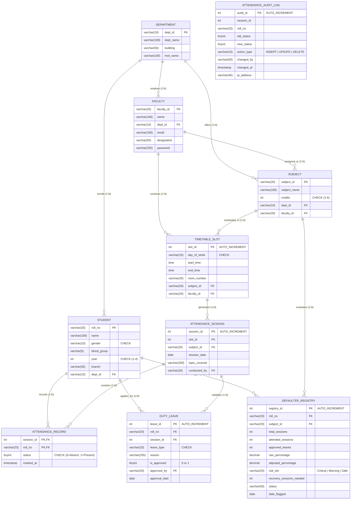

# 🎓 College Student Attendance & Multi-Tier Defaulter Management System
## 📑 Enterprise A to Z Technical Specification, Relational Architecture & Research Report

---

## 📌 1. Executive Summary & Problem Domain

Academic institutions face significant operational hurdles in accurately tracking student attendance, managing referential integrity across multi-period timetable sessions, adjusting attendance for officially sanctioned duty/medical leaves, and enforcing objective defaulter policies without subjective disputes.

The **College Student Attendance & Multi-Tier Defaulter Management System** provides a mathematically grounded, 3NF/BCNF normalized, transactional relational database management platform.

### Core Value Propositions:
- **3NF & BCNF Multi-Tier Academic Hierarchy**: Clean decomposition across Departments, Degree Courses, Subjects, Faculties, Timetable Slots, and Session Instances.
- **Period-Level Granularity**: Attendance tracked per session slot with composite primary key $(session\_id, roll\_no)$ preventing duplicate roll calls.
- **Dual-Metric Engine**: Evaluates **Raw Attendance %** vs. **Adjusted Attendance %** incorporating approved medical & on-duty leaves without mutating historical logs.
- **In-Database Recovery Math**: Automatically computes the exact minimum number of consecutive future lectures ($N$) a student must attend to restore compliance to $\ge 75\%$.
- **Multi-Tier Defaulter Risk & Escalation Matrix**: Tier 1 Critical ($<60\%$), Tier 2 Warning ($60\%-74.99\%$), and Tier 3 Safe ($\ge 75\%$) with automated administrative action triggers.
- **Immutable Audit Logging**: Trigger-based anti-tamper ledger capturing every attendance insert, update, author, timestamp, and IP address.
- **Advanced Window Analytics**: Cohort ranking via `DENSE_RANK()`, `PERCENT_RANK()`, and bottom 10th percentile identification via `NTILE(10)`.

---

## 🏛️ 2. Relational Architecture & Entity-Relationship Modeling (3NF / BCNF)

### 📊 Normalized ER Diagram



---

## 📐 3. Mathematical Foundations & Calculation Engines

### 1. Dual-Metric Attendance Formulation

$$\text{Raw Percentage } (P_{\text{raw}}) = \left( \frac{\sum_{i=1}^{T} \text{status}_i}{T} \right) \times 100$$

$$\text{Adjusted Percentage } (P_{\text{adj}}) = \left( \frac{\sum_{i=1}^{T} \text{status}_i + \sum_{k=1}^{L} \mathbb{I}(\text{approved}_k)}{T} \right) \times 100$$

Where:
- $T$ = Total session instances conducted for the subject.
- $\text{status}_i \in \{0, 1\}$ (Present = 1, Absent = 0).
- $\mathbb{I}(\text{approved}_k) = 1$ if the student's on-duty/medical leave request for an absent session was formally approved by authorized faculty.

---

### 2. In-Database Attendance Recovery Math (Bunk & Recovery Calculator)

To compute the minimum future consecutive lectures ($N$) a student must attend to reach the mandatory $75\%$ attendance threshold:

$$\frac{A + N}{T + N} \ge 0.75$$

$$A + N \ge 0.75(T + N)$$

$$A + N \ge 0.75 T + 0.75 N$$

$$0.25 N \ge 0.75 T - A$$

$$N \ge \frac{0.75 T - A}{0.25}$$

$$N = \left\lceil \frac{0.75 \times T - A}{0.25} \right\rceil = \lceil 3T - 4A \rceil \quad (\text{for } P_{\text{adj}} < 75\%)$$

> [!NOTE]
> If $P_{\text{adj}} \ge 75\%$, $N = 0$. The student is currently safe and can calculate safe bunk capacity using:
> $$\text{Safe Bunks Allowed} = \left\lfloor \frac{A - 0.75 T}{0.75} \right\rfloor$$

---

### 3. Multi-Tier Defaulter Risk & Escalation Matrix

| Risk Tier | Attendance Range | System Classification | Automated Escalation Action |
| :--- | :--- | :--- | :--- |
| **Tier 1 (Critical)** | $0.00\% - 59.99\%$ | `Critical Defaulter` | Triggers formal detention notice, blocks exam hall ticket, and mandates in-person parent conference. |
| **Tier 2 (Warning)** | $60.00\% - 74.99\%$ | `Warning Defaulter` | Triggers faculty mentor counseling flag and automated warning notification. |
| **Tier 3 (Safe)** | $75.00\% - 100.00\%$ | `Safe Status` | Full eligibility for internal assessments and semester end examinations. |

---

## ⚡ 4. Database Integrity, Stored Procedures & Triggers

### 1. Stored Procedures
- **`GenerateMultiTierDefaulters(p_subject_id)`**:
  Executes set-based batch recalculation across cohorts, evaluates both raw and adjusted metrics, calculates recovery sessions ($N$), and populates `defaulter_registry`.
- **`MarkSessionAttendance(p_session_id, p_roll_no, p_status, p_user)`**:
  Wraps individual attendance changes in atomic transactions (`START TRANSACTION ... COMMIT`) with row-level locks and auto-appends to the immutable audit ledger.

### 2. Immutable Audit Triggers
- **`trg_attendance_record_audit_update`**:
  Fires automatically upon any update to `attendance_record`. Captures `OLD.status`, `NEW.status`, `CURRENT_USER()`, and timestamp into `attendance_audit_log` for tamper detection.

---

## 📊 5. Advanced Window Functions & Analytical SQL

Implemented in [`queries.sql`](file:///Users/rahil/Developer/Project/DBMS/queries.sql):

1. **Cohort Percentile Ranking**:
   ```sql
   SELECT roll_no, student_name, branch, adjusted_attendance_percentage,
          DENSE_RANK() OVER (PARTITION BY branch, subject_id ORDER BY adjusted_attendance_percentage DESC) AS subject_rank,
          ROUND(PERCENT_RANK() OVER (PARTITION BY branch, subject_id ORDER BY adjusted_attendance_percentage ASC) * 100, 2) AS percentile_score
   FROM view_raw_vs_adjusted_attendance;
   ```
2. **Bottom 10th Percentile Academic Intervention Isolation**:
   ```sql
   WITH RankedCohort AS (
       SELECT roll_no, student_name, branch, adjusted_attendance_percentage,
              NTILE(10) OVER (PARTITION BY branch ORDER BY adjusted_attendance_percentage ASC) AS decile
       FROM view_raw_vs_adjusted_attendance
   )
   SELECT * FROM RankedCohort WHERE decile = 1;
   ```
3. **Room & Faculty Collision Detection**:
   ```sql
   SELECT t1.slot_id, t2.slot_id, t1.day_of_week, t1.room_number, 'Room Collision Detected' AS alert
   FROM timetable_slot t1
   JOIN timetable_slot t2 ON t1.room_number = t2.room_number 
       AND t1.day_of_week = t2.day_of_week 
       AND t1.slot_id <> t2.slot_id
       AND (t1.start_time < t2.end_time AND t1.end_time > t2.start_time);
   ```

---

## 🚀 6. Execution & Demonstration Modes

| Mode | Command | Description |
| :--- | :--- | :--- |
| **Web Dashboard** | `npm start` $\rightarrow$ `http://localhost:3000` | Full glassmorphic web UI with live SQL console, batch attendance, and table explorer. |
| **Interactive Terminal CLI** | `npm run cli` | Terminal-based interactive management tool. |
| **Python SQLite Runner** | `python3 run_sqlite_demo.py` | Standalone zero-dependency Python script creating `college.db`. |
| **Native MySQL Scripts** | `mysql -u root -p < schema.sql` | Native MySQL script execution with full DDL, DML, triggers & views. |

---

## 📂 7. Artifact Summary

- **[`schema.sql`](file:///Users/rahil/Developer/Project/DBMS/schema.sql)**: Complete 3NF/BCNF DDL with 10 relational tables, composite PKs, FK cascades, and composite indexes.
- **[`views_and_procedures.sql`](file:///Users/rahil/Developer/Project/DBMS/views_and_procedures.sql)**: Relational views, recovery formulas, multi-tier risk matrix, stored procedures, and audit triggers.
- **[`sample_data.sql`](file:///Users/rahil/Developer/Project/DBMS/sample_data.sql)**: Comprehensive preloaded records across departments, faculties, students, slots, sessions, duty leaves, and logs.
- **[`queries.sql`](file:///Users/rahil/Developer/Project/DBMS/queries.sql)**: Analytical SQL with window functions (`PERCENT_RANK`, `DENSE_RANK`, `NTILE`), recovery calculators, and timetable guardrails.
